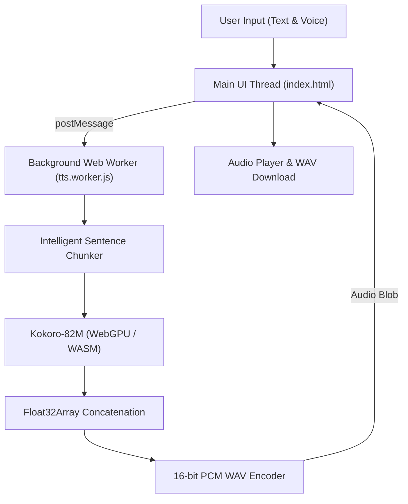

# 🎙️ PureTTS — Free Unlimited AI Text to Speech (100% In-Browser)

[](https://puretts.com)
[](https://dev.to/fs03_c7d3cbdc6bb2eee4d1f1/how-i-built-a-100-free-private-in-browser-ai-text-to-speech-tool-using-kokoro-82m-webgpu-32ih)
[](LICENSE)
[](https://puretts.com)

> **[PureTTS (puretts.com)](https://puretts.com)** is a 100% free, unlimited, and private in-browser Text-to-Speech (TTS) converter. Powered by the open-weight **Kokoro-82M** neural model running directly on client-side **WebGPU** and **WebAssembly**, it generates human-sounding AI voices with zero character limits, zero accounts, and zero cloud server dependencies.

---

## ⚡ Key Highlights

* 🔒 **100% Client-Side Privacy**: Neural AI inference runs entirely inside the user's browser via WebGPU / WASM. Text and audio never leave the local machine.
* ♾️ **Unlimited Text Length**: Built-in intelligent sentence-level chunking and continuous WAV concatenation bypasses the model's 29-second ceiling.
* 🎧 **Studio Quality AI Voices**: Powered by **Kokoro-82M** for natural intonation, cadence, and expression.
* 🚀 **Zero UI Freezing**: All tensor computation and phoneme tokenization is offloaded to a dedicated background **Web Worker** (`tts.worker.js`), maintaining a buttery 60 FPS interface.
* 💾 **Instant 16-bit PCM WAV / MP3 Export**: Generates pristine uncompressed audio on the fly without heavy third-party audio packages.
* 💸 **$0 Cloud Server Costs**: Zero backend GPU clusters. Hosted 100% statically on GitHub Pages with custom domain DNS.

---

## 🏗️ Architecture



---

## 🚀 Local Development

Run a local HTTP server in this directory:

```bash
# Using Python 3
python3 -m http.server 8080

# Or using Node.js
npx serve .
```

Open `http://localhost:8080/` in your browser.

---

## 📁 Repository Structure

```
├── assets/
│   ├── avatar.jpg       # Brand logo, favicon, and OpenGraph preview
│   └── avatar_variant.jpg
├── js/
│   └── tts.worker.js    # Background Web Worker (Kokoro-82M, chunker & WAV encoder)
├── docs/
│   ├── DEPLOY.md        # Deployment guides (GitHub Pages, DNS)
│   └── DEVTO_POST.md    # Published technical article
├── index.html           # Main dark-mode UI, WebGPU client, SEO & GA4
├── ads.txt              # Google AdSense publisher verification
├── llms.txt             # AI crawler standard (Gemini, ChatGPT, Perplexity)
├── robots.txt           # Crawler index directives & sitemap reference
├── sitemap.xml          # XML sitemap for search engines
├── privacy.html         # Privacy Policy (AdSense compliant)
├── terms.html           # Terms of Service
└── LICENSE              # MIT License
```

---

## 📄 License

Distributed under the MIT License. Built with ❤️ for open-source AI and the decentralized web.
